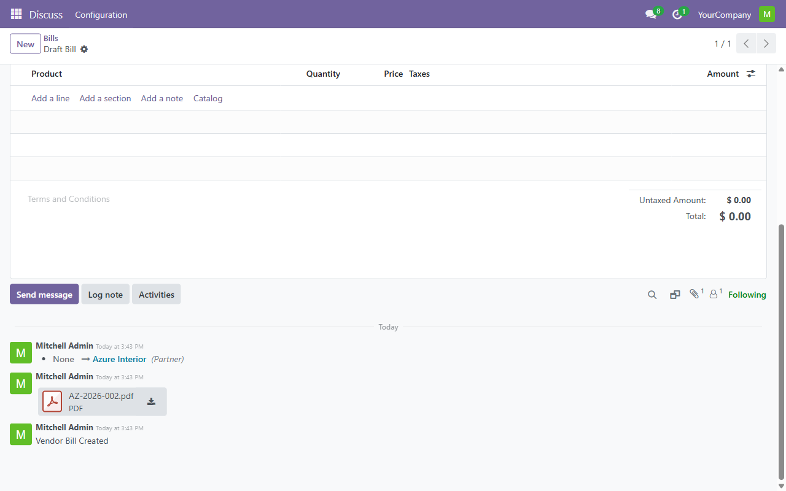

# mailbox-to-odoo

Supplier invoices arrive as PDF attachments in a shared Gmail mailbox. This tool finds them with one Gmail search per supplier, files each PDF in the supplier's folder, and can create a **draft vendor bill in Odoo** with the PDF attached, through the same call Odoo uses when you upload a document to a purchase journal. It reads the mailbox without changing it, skips what is already filed or already in Odoo, and never posts a bill.

Odoo already has a built-in way to turn emailed PDFs into draft bills (the journal email alias). The difference is in how mail is chosen and what is left untouched: see [Alternatives](#alternatives) and the longer comparison in [docs/ALTERNATIVAS.md](docs/ALTERNATIVAS.md).

## See it run

A dry run on made-up mail (`python examples/demo.py`, no network, no credentials). The folder already holds `INV-1001.pdf`; Acme also sent a terms PDF that its rule ignores, and one Globex mail has no attachment:

```
2 new | 1 already there | 1 without PDF
  + Acme Hosting\INV-1002.pdf
  + Globex Telecom\2026-10-01 bill.pdf
  ? Globex Telecom 2026-11-01 'Your bill is ready': no PDF attached
Dry run: --execute to write them.
```

Paths print with your OS separator. Against a real mailbox the command also prints one `Supplier: N mails` line per rule before this summary.

## Install

```
git clone https://github.com/kaiserchiese/invoice-mailbox-to-odoo && cd invoice-mailbox-to-odoo
pip install .
mailbox-to-odoo examples/rules.example.yaml ./Invoices   # dry run; add --execute to write
```

Export the IMAP variables from `.env.example` first (see Configure). Running only the dry run is safe: it reads mail and writes nothing.

## Configure

Credentials come from environment variables only. `.env.example` lists them with fictitious values. The tool does not read a `.env` file, so export the variables in your shell (or load the file with your shell or a process manager).

| Variable | Meaning |
|---|---|
| `MAILBOX_IMAP_USER` | The mailbox address |
| `MAILBOX_IMAP_PASSWORD` | A Google app password (needs 2-step verification on the account) |
| `MAILBOX_IMAP_HOST` | Optional, defaults to `imap.gmail.com` |
| `ODOO_URL`, `ODOO_DB`, `ODOO_USER`, `ODOO_API_KEY` | Only for `--odoo`. The API key is created in the Odoo user's preferences |
| `ODOO_JOURNAL` | Optional purchase journal code |

Suppliers go in a rules file, one entry each. `query` is what you would type in Gmail's search box. `attachment` is an optional regex on the file name, case-insensitive, for suppliers that also send annexes or contracts. A rule with no `query` is skipped, which is how you keep a supplier whose invoices come from a web portal in the same file.

```yaml
since: 2026-01-01          # mails before this date are ignored
rules:
  - name: Acme Hosting
    folder: Acme Hosting   # under the root folder you pass on the command line
    query: 'from:billing@acme.test has:attachment filename:pdf'
    attachment: '^INV-'
    partner: Acme Hosting  # optional, for --odoo: exact vendor name or vat:ESxxxx
```

It also works as a library when your project has its own config:

```python
from datetime import date
from pathlib import Path

from mailbox_to_odoo import folder, imap
from mailbox_to_odoo.rules import Rule

since, root = date(2026, 1, 1), Path("Invoices")
rule = Rule(name="Acme", folder="Acme", query="from:billing@acme.test")
with imap.connect(imap.Credentials.from_env()) as conn:
    mails = [(rule, m) for m in imap.search_rule(conn, rule, since)]
plan = folder.plan(root, mails)   # what would be written; nothing touched yet
folder.write(plan)
```

## Rules for filing

- A PDF already in the supplier folder (any subfolder, any name) is not written again.
- A file with the same name counts as the same invoice even when the bytes differ. Some billing platforms re-render the PDF on every send, and filing both would book the invoice twice.
- The same name twice in one run is also one invoice: the first is filed, the second counts as already there. Existing files are never overwritten.
- An attachment with no digit in its name gets the mail date in front, so two months of `invoice.pdf` do not collide.
- Mails that match a rule but carry no PDF are listed, not ignored. Mails whose PDFs all fail the `attachment` filter are skipped without a warning.
- The same PDF can be filed under two suppliers when two rules match it; each folder is checked on its own.

## Draft bills in Odoo

```
export ODOO_URL=http://127.0.0.1:18069 ODOO_DB=demo ODOO_USER=admin ODOO_API_KEY=...
mailbox-to-odoo rules.yaml --odoo              # dry run: what would be created
mailbox-to-odoo rules.yaml --odoo --execute    # create the draft bills
mailbox-to-odoo rules.yaml --odoo --execute --watch 15   # repeat every 15 minutes
```

Add `partner:` to a rule (the exact vendor name in Odoo, or `vat:ES12345678`) to set the supplier. Without it the bill has no supplier; one is never guessed. A name that matches zero or several vendors is an error and nothing is sent for that rule. `ODOO_JOURNAL` (a purchase journal code) picks the journal; empty means Odoo's first purchase journal. Try it on a throwaway Odoo (a few minutes, mostly the first start): [examples/odoo/compose.yaml](examples/odoo/compose.yaml) and `python examples/odoo_demo.py`.

A draft bill the tool made in Odoo 18 Community (demo data): the PDF is attached and the supplier set from the rule. Real run and output in [docs/PRUEBA-ODOO.md](docs/PRUEBA-ODOO.md).



How it behaves:

- One draft vendor bill per PDF, created by `account.journal.create_document_from_attachment`, the entry the Odoo dashboard upload uses. Whether Enterprise or Online then digitize it is not tested here. On Community there is no OCR: you get a draft with the PDF attached.
- The tool never posts. Odoo can: in 18, a company with "auto-post bills" on and a vendor set to "always" posts on its own, and Community's e-invoice importer can read XML embedded in a PDF. The tool reports a bill that is no longer a draft and leaves its supplier alone.
- Idempotent: a PDF is skipped when its mail is already in Odoo (a marker in the attachment description), when the same bytes are already on a bill, or when the same file name is on a bill of the same supplier. Running twice creates one bill.
- Dry run by default. A run lock (`.mailbox-to-odoo.lock` next to the rules file) refuses a second `--odoo --execute` run; a stop signal releases it, a hard kill leaves it, so delete the file if no run is alive.
- API access needs a user and key. On Odoo Online that means the Custom plan.

Limits you should know:

- Not atomic: a crash between upload and conversion leaves an attachment; the next run replaces it.
- One machine only. Two machines running `--execute` against one Odoo can create the same bill twice.
- Cancel an unwanted draft, do not delete it: a deleted draft is created again on the next run.
- The same bytes under another supplier count as the same invoice.
- Odoo's OCR trigger is Enterprise code that is not public, so it is not tested here. Run for real on Community 18 and 17 with demo data: see [docs/PRUEBA-ODOO.md](docs/PRUEBA-ODOO.md).
- JSON-RPC (`/jsonrpc`) is the API of Odoo 17 and 18; Odoo announces its retirement and a JSON-2 API as the replacement.

The design and the reading of Odoo's source behind each check are in [docs/PLAN-ODOO.md](docs/PLAN-ODOO.md).

## Alternatives

Compared on 2026-11-24, stars from GitHub.

| Option | What it is | Where it wins | Where this one wins |
|---|---|---|---|
| Odoo's own vendor-bill email alias (Community) | Odoo creates one draft bill per PDF in a mail sent to the journal's alias | Built in and free, no API access needed. Better if supplier mail can be redirected to the alias. | Reads mail where it already is, including read and archived mail, without marking it; picks PDFs per supplier rule instead of taking every attachment; the vendor comes from the rule, not the sender address; dry run first. |
| [invoice2data](https://github.com/invoice-x/invoice2data) (2.2k stars, MIT) | Extracts fields (number, date, total) from PDF invoices with templates | Reads what is inside the PDF, which this tool never does. | It fetches the mail, which invoice2data does not. The two combine: fetch with this, parse with that. |
| [Invoice-Downloader](https://github.com/EthanYoQ/Invoice-Downloader) (557 stars, Apache-2.0) | Desktop app that collects invoices from a mailbox, runs OCR and builds Excel summaries | Much broader: OCR, several file types, a GUI. | Smaller, built around per-supplier Gmail queries and one folder per supplier. The other targets Chinese e-invoices. |

## Limitations

- Gmail and Google Workspace only. It relies on Gmail's `X-GM-RAW` search and the `\All` folder. Another provider needs a plain IMAP search translation of each query.
- Login is a Google app password. There is no OAuth flow.
- A mail with no `Date` header stops the run with an error instead of being skipped.
- It never opens the PDFs, so an attachment that is not really an invoice is filed if its name matches.
- The Odoo step is documented above with its own limits.

## Develop

```
pip install -e ".[dev]"
ruff check src tests && mypy && pytest --cov=mailbox_to_odoo
```

See [CONTRIBUTING.md](CONTRIBUTING.md). Licensed under the [MIT License](LICENSE).
