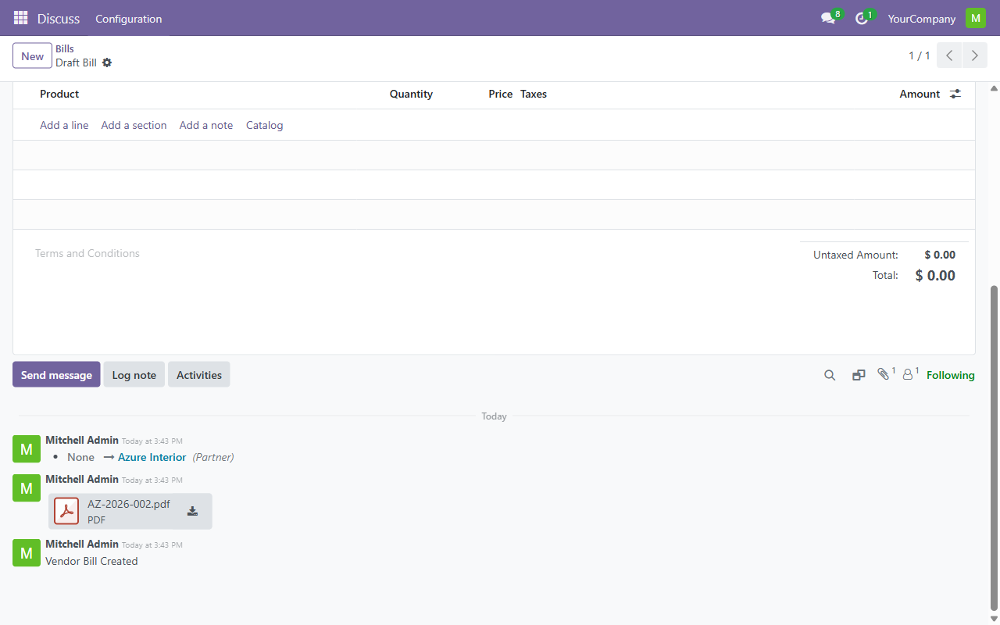

# Real test against a local Odoo

Run on 2026-11-24 against throwaway Odoo containers from `examples/odoo/compose.yaml` (Postgres 16, database `demo`,
login `admin` / `admin`, the demo data of `-i account`). No real Odoo, no real credentials. The containers and their
volumes were removed afterwards with `docker compose down -v`.

| | Odoo 18 | Odoo 17 |
|---|---|---|
| Server version | `18.0-20261112` | `17.0-20260908` |
| Modules | `account`, `account_edi_ubl_cii` (no OCR: Community) | same |
| 3 PDFs, `--execute` | 3 draft vendor bills | 3 draft vendor bills |
| Second run | 0 new, 3 already in Odoo | 0 new, 3 already in Odoo |
| Supplier on the two Azure Interior bills | set | set |
| Bill without a rule supplier | no supplier | no supplier |

Not tested: Enterprise or Online digitization (`account_invoice_extract` is private code). On Community the bills have no
lines and a total of 0.00, as the README says. Not timed: no speed figure is claimed. The mails are three made-up
messages built by `examples/odoo_demo.py` (a hand-made PDF each); the IMAP side is covered by the unit tests, not by this
run. Cancelling a bill (instead of deleting it) was not run. The edge cases below were run on 18 only; the 17 run is the plain create-and-repeat.

## Odoo 18: dry run, create, run again

```
$ python examples/odoo_demo.py

Odoo: 3 new | 0 already in Odoo | 0 rule errors
  + Azure Interior: AZ-2026-001.pdf
  + Azure Interior: AZ-2026-002.pdf
  + Unknown supplier: UN-77.pdf
Dry run: --execute to create the draft bills.
exit=0

$ python examples/odoo_demo.py --execute

Odoo: 3 new | 0 already in Odoo | 0 rule errors
  + Azure Interior: AZ-2026-001.pdf
  + Azure Interior: AZ-2026-002.pdf
  + Unknown supplier: UN-77.pdf
  AZ-2026-001.pdf -> bill 25
  AZ-2026-002.pdf -> bill 26
  UN-77.pdf -> bill 27
exit=0

$ python examples/odoo_demo.py --execute   (second run)

Odoo: 0 new | 3 already in Odoo | 0 rule errors
  = AZ-2026-001.pdf (mail already in Odoo)
  = AZ-2026-002.pdf (mail already in Odoo)
  = UN-77.pdf (mail already in Odoo)
exit=0
```

What Odoo holds afterwards (read back over JSON-RPC):

```
---- bills
{'id': 27, 'name': False, 'state': 'draft', 'move_type': 'in_invoice', 'partner_id': False, 'journal_id': [2, 'Vendor Bills'], 'invoice_line_ids': [], 'amount_total': 0.0}
{'id': 26, 'name': False, 'state': 'draft', 'move_type': 'in_invoice', 'partner_id': [15, 'Azure Interior'], 'journal_id': [2, 'Vendor Bills'], 'invoice_line_ids': [], 'amount_total': 0.0}
{'id': 25, 'name': False, 'state': 'draft', 'move_type': 'in_invoice', 'partner_id': [15, 'Azure Interior'], 'journal_id': [2, 'Vendor Bills'], 'invoice_line_ids': [], 'amount_total': 0.0}
---- attachments
{'id': 823, 'name': 'UN-77.pdf', 'res_id': 27, 'mimetype': 'application/pdf', 'file_size': 623, 'description': 'mailbox-to-odoo:<u1@unknown.test>:18ba5c2a70cf53b867e05b8931848cbbc69556e3fdbf099697dc645e625999fb'}
{'id': 822, 'name': 'AZ-2026-002.pdf', 'res_id': 26, 'mimetype': 'application/pdf', 'file_size': 630, 'description': 'mailbox-to-odoo:<a2@azure.test>:acc25561d1a5f135db4c8966abc6a285b2ef1e2b13ed11f4c10a7d50560529e6'}
{'id': 821, 'name': 'AZ-2026-001.pdf', 'res_id': 25, 'mimetype': 'application/pdf', 'file_size': 632, 'description': 'mailbox-to-odoo:<a1@azure.test>:ce658896e74c5909c94782e0a2e47c0e00d55bbaf4a1324763a2c9204ad6319a'}
```

Screenshots at 1280 px: [the bill list](img/odoo-bills.png), [the bill form](img/odoo-bill.png) and
[the chatter of bill 26](img/odoo-bill-attachment.png), which shows `AZ-2026-002.pdf` attached, the supplier set and
"Vendor Bill Created".



## Odoo 18: the limits in the README, tried

```
1 delete a draft by hand, rerun:
  attachment left after deleting bill 25: []
  rerun -> ([], [], [('AZ-2026-001.pdf', 28)], [])
2 same PDF bytes, other mail and other name:
  -> ([('renamed.pdf', 'same PDF already on a bill')], [], [], [])
3 same file name, same supplier, other bytes:
  -> ([('AZ-2026-002.pdf', 'same file name already on a bill of this supplier')], [], [], [])
4 vat: rule with a child contact:
  child vat: [{'id': 43, 'vat': 'ESB00000000'}]
  -> ([], ["rule 'Vat': 2 vendors with vat 'ESB00000000' in Odoo; nothing sent for it"], [], [])
```

- 1: a bill deleted by hand is created again on the next run (its attachment goes with it). That is why the README says
  cancel, do not delete.
- 2 and 3: the same bytes under another name, and the same file name with other bytes for the same supplier, are both
  skipped.
- 4: this run found a bug. Odoo copies the vat of a company onto its contacts, so `vat:ESB00000000` matched two partners
  and sent nothing. The rule now looks at top-level partners only (commit ea2993e, with a unit test). Same rule after the
  fix, same database:

```
errors: [] [] created: [('VT-1.pdf', 29)]
[{'id': 29, 'state': 'draft', 'partner_id': [42, 'Vat Test SL']}]
```

## Odoo 17

```
17.0-20260908
partners: ['Azure Interior']
journals: [{'id': 2, 'code': 'BILL', 'name': 'Vendor Bills'}]
modules: ['account', 'account_edi_ubl_cii']
$ python examples/odoo_demo.py --execute

Odoo: 3 new | 0 already in Odoo | 0 rule errors
  + Azure Interior: AZ-2026-001.pdf
  + Azure Interior: AZ-2026-002.pdf
  + Unknown supplier: UN-77.pdf
  AZ-2026-001.pdf -> bill 25
  AZ-2026-002.pdf -> bill 26
  UN-77.pdf -> bill 27
exit=0
(second run)

Odoo: 0 new | 3 already in Odoo | 0 rule errors
  = AZ-2026-001.pdf (mail already in Odoo)
  = AZ-2026-002.pdf (mail already in Odoo)
  = UN-77.pdf (mail already in Odoo)
exit=0
```

What Odoo 17 holds afterwards:

```
{'id': 25, 'state': 'draft', 'move_type': 'in_invoice', 'partner_id': [14, 'Azure Interior']}
{'id': 26, 'state': 'draft', 'move_type': 'in_invoice', 'partner_id': [14, 'Azure Interior']}
{'id': 27, 'state': 'draft', 'move_type': 'in_invoice', 'partner_id': False}
[{'id': 755, 'name': 'UN-77.pdf', 'res_id': 27, 'mimetype': 'application/pdf'}, {'id': 754, 'name': 'AZ-2026-002.pdf', 'res_id': 26, 'mimetype': 'application/pdf'}, {'id': 753, 'name': 'AZ-2026-001.pdf', 'res_id': 25, 'mimetype': 'application/pdf'}]
```
